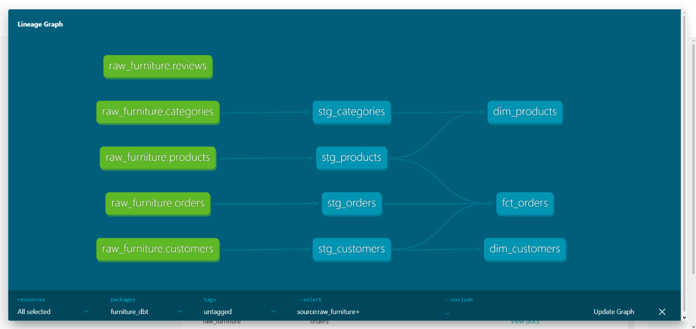
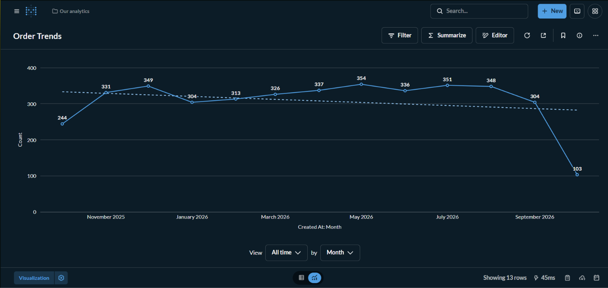
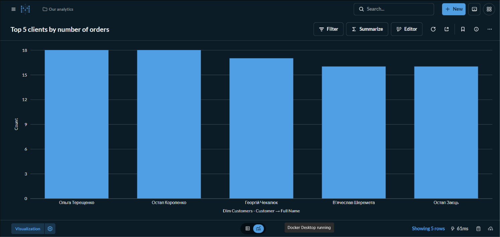

## Опис проєкту
Проєкт реалізує початковий етап ELT-конвеєра (Extract & Load) для аналітичного сховища даних інтернет-магазину меблів (**Варіант 1**). 

## Предметна область та структура даних
Дані згенеровано з імітацією транзакційного середовища (OLTP) та збережено у двох шарах:
1. **Data Lake** (`data_lake/`) — збереження в колонковому форматі Parquet.
2. **DWH Raw Layer** (PostgreSQL, схема `raw`) — завантаження "сирих" даних без агрегації.

### Таблиці:
* **Виміри (Dimensions):**
  * `categories` — категорії меблевої продукції.
  * `products` — асортимент меблів із цінами та статусами.
  * `customers` — клієнти магазину (містить 10% пропущених email та 5% дублікатів для подальшого очищення).
* **Факти (Facts):**
  * `orders` — історія замовлень із прив'язкою до товарів та клієнтів.
  * `reviews` — оцінки та текстові відгуки покупців (20% відгуків навмисно не містять коментарів/NULL).

## Стек технологій
* **Python 3.x** (`pandas`, `faker`, `pyarrow`, `sqlalchemy`, `psycopg`)
* **Docker & Docker Compose** (PostgreSQL 15)
* **Git & GitHub**

## Інструкція із розгортання та запуску

1. **Клонування репозиторію:**
   ```bash
   git clone <посилання_на_ваш_репозиторій>
   cd modern-data-stack-furniture

## Лабораторна робота №2: Analytics Engineering (dbt)
Трансформація даних реалізована за допомогою dbt (Data Build Tool) на базі методології розмірнісного моделювання (схема "Зірка").

**Структура шарів:**
1. **Staging (Очищення):** 
   - `stg_customers`: видалення дублікатів та заповнення порожніх email.
   - `stg_products`: перевірка та очищення від'ємних цін.
   - `stg_orders`, `stg_categories`, `stg_reviews`: кастинг типів даних.
2. **Marts (Вітрини даних):** 
   - `dim_customers`, `dim_products` (виміри).
   - `fct_orders` (таблиця фактів із розрахунком `total_amount = quantity * price`).

## Лабораторна робота №3: Оркестрація та Data Quality (Apache Airflow)
Для автоматизації конвеєра даних (Data Pipeline) розгорнуто локальне середовище Apache Airflow та створено направлений ациклічний граф (DAG) `furniture_elt_pipeline`, який об'єднує всі попередні етапи в єдиний процес.

**Структура автоматизованого ELT-конвеєра:**
1. `extract_and_load_raw_data` (**PythonOperator**): Видобуток транзакційних даних меблевого інтернет-магазину та їх завантаження у `raw` шар DWH.
2. `dbt_run_transformations` (**BashOperator**): Трансформація "сирих" даних та побудова аналітичної схеми "Зірка" (шари `staging` та `marts`).
3. `dbt_test_data_quality` (**BashOperator**): Запуск перевірок якості даних (Data Quality Gates). Налаштовано тести на унікальність (`unique`) та відсутність порожніх значень (`not_null`) для ключових полів.

**Розклад виконання (Schedule):** Щоденно (`@daily`).

## Лабораторна робота №4: BI-дашборди та Data Lineage
Фінальний етап проєкту об'єднує підготовлені вітрини даних із системами бізнес-аналітики (BI) та формує карту Data Lineage для забезпечення Data Governance.

**Технічна реалізація:**
* **BI-система:** Розгорнуто `Metabase` у Docker, який підключено до аналітичної бази PostgreSQL.
* **Візуалізація:** На основі таблиці `fct_orders` та `dim_customers` створено аналітичні дашборди:
  1. *Динаміка замовлень* (Лінійний графік по місяцях).
  2. *Топ-5 клієнтів за кількістю замовлень* (Стовпчикова діаграма).
* **Data Lineage:** За допомогою інструментарію dbt згенеровано статичну документацію (Docs as Code) та побудовано інтерактивний граф походження даних.

**Результати візуалізації:**

*Граф Data Lineage (dbt):*


*Динаміка замовлень (Metabase):*


*Топ-5 клієнтів (Metabase):*

